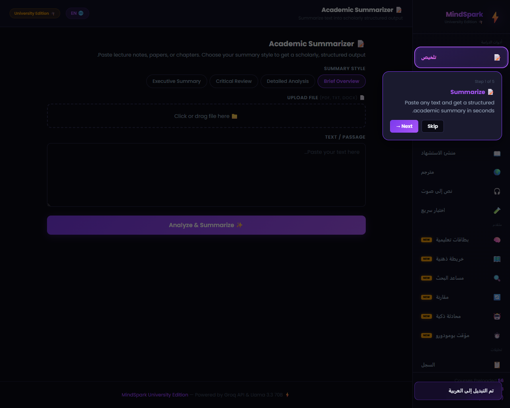
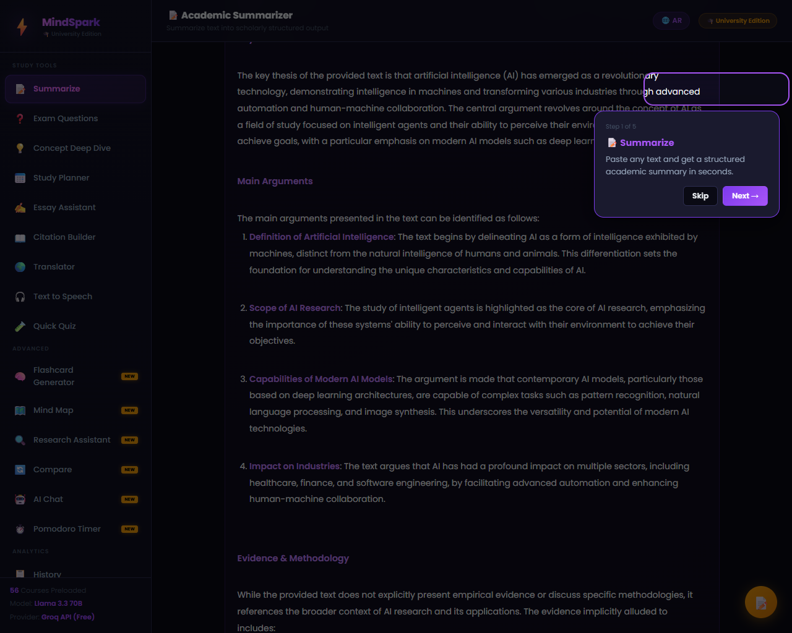
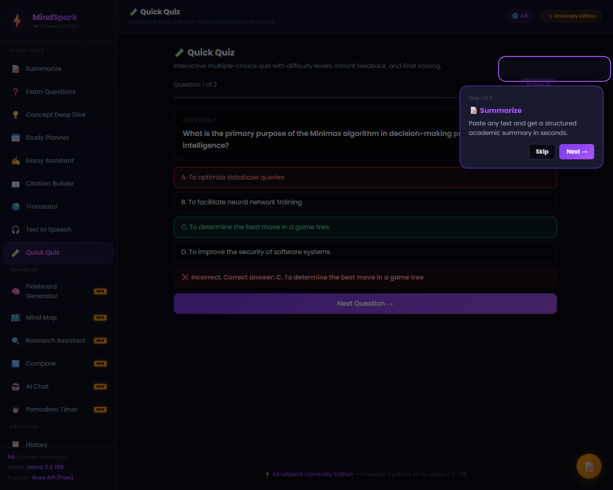
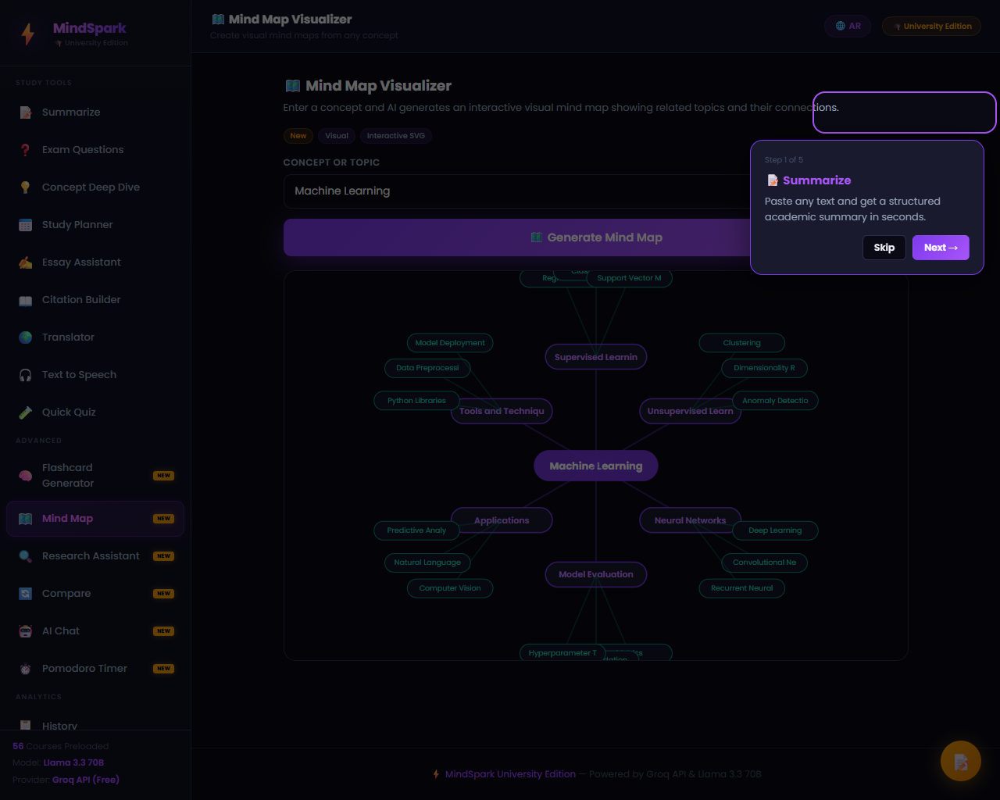
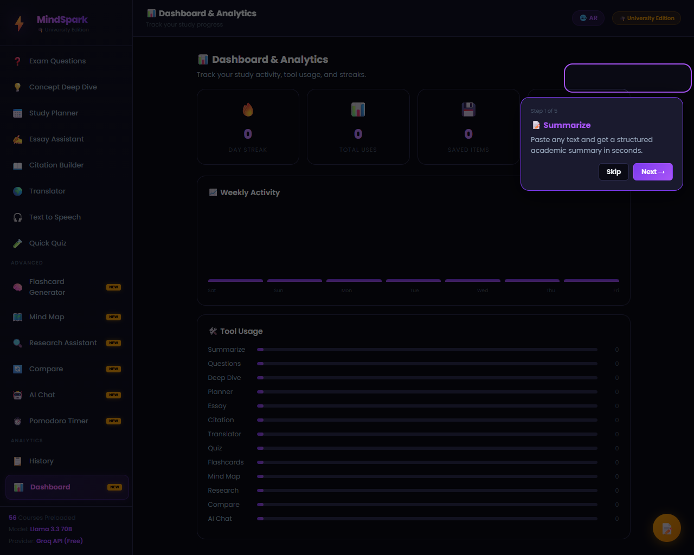

# 🎓 ملف الشرح الكامل لمشروع التخرج الأكاديمي — Aethera (University Edition)

## 👤 بيانات المتدرب والبرنامج التدريبي
- **اسم المتدرب:** عمر سعيد محمد كامل
- **كود المتدرب:** `AI8 - G3 - 0543`
- **البرنامج التدريبي:** برنامج سفراء الذكاء الاصطناعي (المستوى الأول) - الدفعة الثامنة (AI Ambassadors Program)
- **رابط الاستضافة المباشر (Netlify Live URL):** [mindsparkproo.netlify.app](https://mindsparkproo.netlify.app/)
- **رابط المجلد المحلي للمشروع (Local Folder Path):** `D:\Projects\sofraa`

---

## ⚡ تقديم عام عن المشروع (Aethera — University Edition)
تعد منصة **Aethera — University Edition** نظاماً أكاديمياً متكاملاً وفائق التطور صُمم خصيصاً لمساعدة طلاب الجامعات في تنظيم وتبسيط دراستهم وتحسين إنتاجيتهم العلمية. تعتمد المنصة على نموذج الذكاء الاصطناعي الفائق **Llama 3.3 70B Versatile** المقدم بشكل مجاني فائق السرعة عبر سحابة **Groq API**.

تطورت المنصة لتصبح تطبيق **Full-Stack** متكامل يعمل بمرونة فائقة محلياً وسحابياً، حيث يجمع بين واجهة العميل العصرية السريعة (SPA) وسيرفر خادم متطور (Node.js + Express) وقواعد بيانات متكاملة محلياً وسحابياً (SQLite & Supabase PostgreSQL)، مع دعم للتكامل الحي مع أدوات الإنتاجية العالمية مثل **Notion Sync**.

---

## 🛠️ البنية التقنية والتقنيات المستخدمة (Full-Stack Architecture)

1. **Groq Cloud API (Llama 3.3 70B):** تأمين الاتصال الفوري بنموذج الذكاء الاصطناعي وتمرير المطالبات الأكاديمية بدقة وسرعة فائقة.
2. **Node.js & Express Backend:** سيرفر محلي وسحابي يدير مسارات الـ REST APIs والأمان والمزامنة وإرسال الإيميلات.
3. **SQLite Database (Local Persistence):** قاعدة بيانات سريعة تضم أكثر من 17 جدولاً مهيكلاً لحفظ بيانات المستخدمين، المواد الدراسية، المحاضرات، الكروت التفاعلية، الخرائط الذهنية، نتائج الاختبارات، والتحديثات.
4. **Supabase & PostgreSQL Schema (`schema.sql`):** ملف DDL متكامل مجهز لرفع المنصة سحابياً على Supabase مع دعم امتداد **`pgvector`** لاستعلامات البحث الذكي RAG وسياسات الأمان الصفية (RLS).
5. **Notion Sync Integration (Live API):** إمكانية الربط والمزامنة الحية مع جداول ومستندات المستخدم في **Notion API** لتصدير الملخصات والملاحظات فورياً مع فحص وتعديل الـ IDs تلقائياً.
6. **PDF.js & DOCX Parser:** استخلاص النصوص وتفريغ المحاضرات مباشرة من ملفات الطلاب الجامعية (PDF, TXT, DOCX) محلياً بالكامل.
7. **Web Speech API:** تحويل النصوص الأكاديمية إلى كلام منطوق (Text-to-Speech) وتحويل الصوت إلى نصوص (Speech-to-Text).
8. **Responsive Cyberpunk Dark Theme:** تصميم عصري جذاب بدعم كامل للـ RTL/LTR والترجمة الفورية المباشرة للغة العربية.

---

## 📋 أدوات المنصة الأكاديمية الشاملة (أكثر من 30 أداة وتجهيز)

### 1. أدوات الدراسة الأكاديمية (Study Tools):
- **الملخص الأكاديمي (Academic Summarizer):** تلخيص المحاضرات والكتب العلمية بأربعة أساليب أكاديمية مختلفة (موجز، تفصيلي، نقد علمي، ملخص تنفيذي) مع زر التصدير الفوري لـ **Notion Sync**.
- **منشئ أسئلة الامتحانات (Exam Question Generator):** بناء أسئلة تحاكي الامتحانات الحقيقية (اختيار من متعدد، مقالي، قصير، صواب وخطأ، دراسة حالة) بـ 4 مستويات صعوبة مختلفة.
- **الشرح المعمق للمفاهيم (Concept Deep Dive):** تحليل أكاديمي للمصطلحات يشمل التعريف الإجرائي والمنظور التاريخي وأشهر العلماء والعلل الشائعة.
- **مخطط الدراسة الذكي (Smart Study Planner):** وضع جداول دراسية مخصصة زمنياً تعتمد على موعد الامتحان وساعات الدراسة اليومية وطرق التعلم المختلفة.
- **مساعد المقالات الجامعية (Essay Assistant):** اقتراح صياغات للأطروحة العلمية وبناء الهيكل التنظيمي للمقالات وعرض الحجج والردود المقابلة.
- **ملاحظات كورنيل (Cornell Notes):** تحويل المحاضرات إلى هيكل كورنيل الأكاديمي المخصص لزيادة التركيز والحفظ.
- **منشئ الاستشهادات المرجعية (Citation Builder):** توليد فوري للتوثيق المرجعي بـ 6 صيغ أكاديمية شهيرة مثل APA 7th و MLA 9th للمصادر المختلفة.
- **المترجم الذكي (Smart Translator):** ترجمة النصوص والمصطلحات الأكاديمية لـ 6 لغات مختلفة مع الحفاظ على النبرة والمصطلحات العلمية بدقة.
- **النص المسموع (Text to Speech):** محرك صوتي يقرأ الملخصات والمحتوى بصوت مسموع لتعزيز الحفظ البصري والسمعي المشترك.
- **مكتبة المحاضرات (Lectures Library):** رفع وأرشفة المحاضرات والكتب وتحليلها محلياً.

### 2. الأدوات التفاعلية والتقدم العلمي (Interactive Learning):
- **منشئ البطاقات التعليمية (Flashcard Generator):** توليد بطاقات تفاعلية ذكية للمراجعة وحفظ التعريفات مع إمكانية خلط البطاقات ومتابعة التقدم والتصدير لـ **Anki**.
- **مخطط الخرائط الذهنية (Mind Map Visualizer):** رسم خرائط ذهنية هرمية تفاعلية بصيغة SVG لتبسيط استيعاب بنية المفاهيم وتسهيل تذكرها.
- **الاختبار السريع (Quick Quiz):** توليد اختبارات تفاعلية تلقائية بالاعتماد على مخرجات الذكاء الاصطناعي بصيغة JSON مع التقييم الفوري وإظهار الإجابات الصحيحة والدرجة النهائية.
- **مساعد المحادثة الذكي (AI Chat):** شات بوت تفاعلي واعي بالسياق يقدم استشارات وحوارات تعليمية مستمرة حول أي تخصص.

### 3. أدوات الذكاء الاصطناعي المتقدمة (Advanced AI Tools):
- **مساعد الأبحاث (Research Assistant):** صياغة موجز بحثي شامل يغطي زوايا الطرح والمنهجيات المقترحة والنظريات المرتبطة بالموضوع.
- **أداة المقارنة الثنائية (Compare Tool):** مقارنة side-by-side للنظريات والكتب العلمية والمصطلحات.
- **محلل السرقات الأدبية (Plagiarism Analyzer):** فحص نسبة الأصالة في المقالات والأبحاث.
- **المصحح التلقائي للاختبارات (Essay Auto-Grader):** تقييم وتصحيح الإجابات المقالية وتزويد الطالب بملاحظات تحسين مستندة إلى الإجابة النموذجية.
- **شارح الكود (Code Explainer):** تحليل وشرح الأكواد البرمجية خطوة بخطوة.
- **مصحح القواعد (Grammar Checker):** تدقيق النصوص وتصحيح الأخطاء اللغوية والنحوية.

### 4. الأدوات الإنتاجية والتخطيط (Productivity Suite):
- **حاسبة المعدل التراكمي (GPA Calculator):** حاسبة مرنة تدعم الأنظمة المصرية والأمريكية، مع **إمكانية إضافة وإزالة السيمسترات (`+ Semester` / `- Semester`)** وحساب الـ Semester GPA والـ Cumulative GPA وتحديد الدرجات المطلوبة فورياً.
- **مؤقت بومودورو (Pomodoro Timer):** مؤقت دراسة مدمج يساعد في زيادة التركيز بتقسيم الوقت (جلسة دراسة 25 دقيقة يتبعها استراحة قصيرة).
- **التقويم الأكاديمي (Academic Calendar):** تتبع مواعيد الامتحانات والمشاريع والواجبات.
- **متابع الأهداف (Goal Tracker):** تحديد وإدارة الأهداف الدراسية والأكاديمية.

### 5. السجلات والتحليلات (Analytics & Database Persistence):
- **إدارة المواد والمناهج (`courses` API):** إضافة وتنظيم المواد وتلوينها وحفظها في قاعدة البيانات.
- **مجتمع المشاركة الطلابية (`shared_resources` API):** رفع ومشاركة الملخصات والكروت بين الطلاب وتلقي التقييمات والإعجابات.
- **سجل المحفوظات (History System):** أرشفة ذكية تحفظ مخرجات الطلاب وتتيح تصفحها ونسخها وحذفها.
- **لوحة المعلومات والتحليلات (Dashboard & Analytics):** تتبع نشاط الدراسة الأسبوعي وعداد الأيام المتتالية واستخدام الأدوات والأوسمة العلمية (Badges).

---

## 🗄️ تفاصيل ونموذج قاعدة البيانات (Database Schemas)

تتضمن المنصة **17 جدولاً مهيكلاً بالكامل**:
1. `users`: بيانات حسابات الطلاب وتشفير كلمة المرور.
2. `profiles`: الملف الأكاديمي، الكلية، التخصص، والكود.
3. `usage_stats`: النقاط، المستوى، الأوسمة، وأيام المذاكرة.
4. `saved_notes`: الملاحظات والمخرجات المحفوظة.
5. `chat_sessions` & `chat_messages`: سجل المحادثات الذكية.
6. `courses`: المواد والكورسات الدراسية وتلوينها.
7. `documents`: المحاضرات والـ PDFs والنصوص المستخرجة.
8. `document_embeddings`: مقاطع النصوص المجهزة للـ Vector Search و RAG.
9. `flashcard_decks` & `flashcards`: مجموعات البطاقات والتكرار المتباعد.
10. `quiz_results`: تاريخ ونتائج الاختبارات والدرجات.
11. `mind_maps`: شجرة بيانات الخرائط الذهنية بصيغة SVG/JSON.
12. `study_plans`: خطط الدراسة الموزعة حتى موعد الامتحانات.
13. `shared_resources` & `resource_reviews`: مجتمع المشاركة بين الطلاب والتقييمات.
14. `subscriptions` & `audit_logs`: الاشتراكات وسجلات أمان العمليات.

---

## 🖼️ توثيق خطوات العمل والتطبيق الفعلي بالصور

### 1. واجهة التطبيق الرئيسية وبطاقة التخرج المخصصة

- **الشرح:** تظهر الواجهة الداكنة الفاخرة المميزة باسم التطبيق **Aethera** مع الدعم الكامل للتبديل الفوري بين اللغة العربية والإنجليزي (RTL/LTR).

### 2. التلخيص الأكاديمي والمزامنة الحية مع Notion (Notion Sync Integration)

- **الشرح:** تتيح أداة **Academic Summarizer** رفع الملفات وتوليد ملخصات تفصيلية، متبوعة بزر **`⚡ Sync to Notion`** والذي يقوم بتصدير الملخص فورياً وإنشاء صفحة جديدة منسقة داخل حساب الطالب في Notion API.

### 3. حاسبة المعدل الجامعي وتخصيص السيمسترات (GPA Calculator)
- **الشرح:** توفر حاسبة GPA إمكانية إضافة وإزالة السيمسترات بسهولة بفضل زر **`- Semester`** الجديد، مع التقييم اللحظي للمعدل التراكمي وتحديد المتطلبات للوصول للدرجة المطلوبة.

### 4. الاختبار التفاعلي والخرائط الذهنية بصيغة SVG

- **الشرح:** توليد اختبارات سريعة وتقييم فوري بالدرجات، وتحويل المفاهيم إلى خرائط ذهنية تفاعلية متناسقة ومتفاعلة مع حركة الماوس.

### 5. لوحة البيانات السحابية ومؤقت التركيز ومجتمع المشاركة

- **الشرح:** متابعة دقيقة لمعدل الساعات والدقائق اليومية، الأيام المتتالية (Streak)، والأوسمة المحققة مع ربط البيانات بالسيرفر وقاعدة البيانات.

---

## 🏁 خاتمة
يمثل مشروع **Aethera — University Edition** نموذجاً مثالياً احترافياً للتطبيقات المتكاملة (Full-Stack AI Products) التي عكست شغف وقدرات المتدرب في برنامج **سفراء الذكاء الاصطناعي**. يعكس المشروع دمج الذكاء الاصطناعي الفائق مع بنية قواعد بيانات قوية وتكاملات سحابية مع تطبيقات عالمية كـ Notion تخدم المجتمع التعليمي بأسلوب مميز ورائع.
